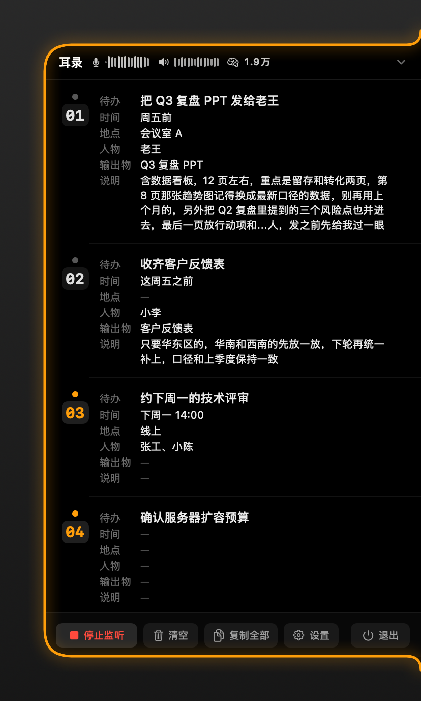
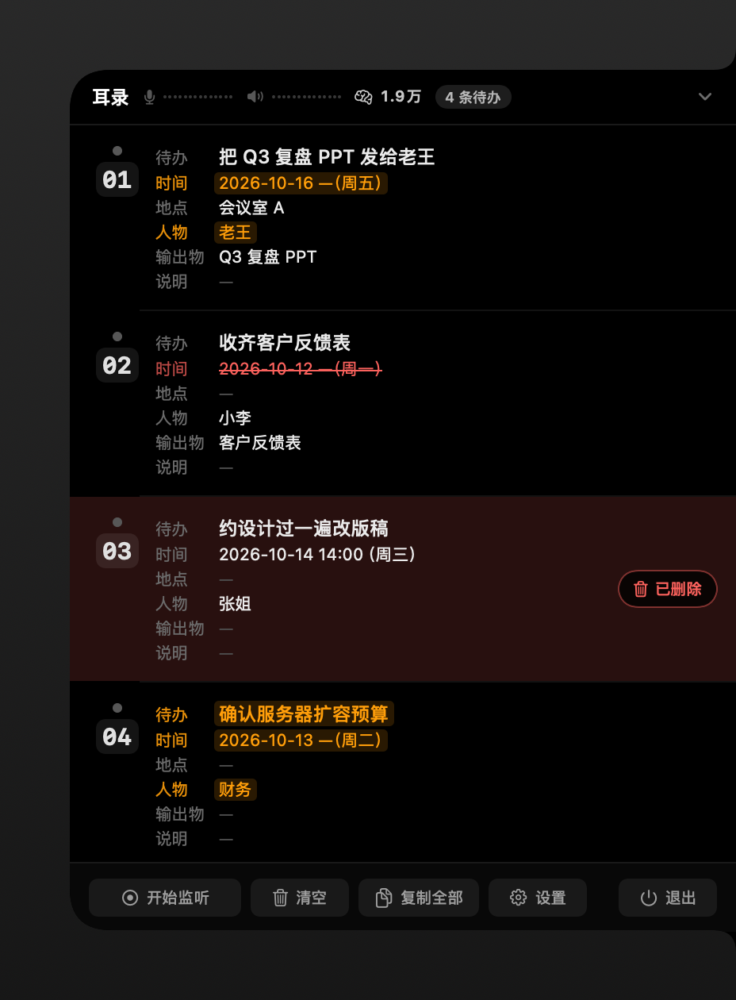

# 耳录 EarShot

> 开会不用记笔记。它替你听，**待办自动列到屏幕边上**。

[](https://github.com/smarty-kiki/ear_shot/actions/workflows/ci.yml)
[](https://github.com/smarty-kiki/ear_shot/releases)
[](LICENSE)


开着它开会：**麦克风**里是你，**电脑里**是会议对方，两边的话一起听、在你自己电脑上转成文字，几秒内就把「谁、什么时候、要交什么」一条条列在屏幕右边。开完会，待办已经排好了。

<p align="center">
  
</p>

## 为什么是它

- **你和对方的声音都听得见。** 一路听麦克风（你），一路听电脑里播放的声音（会议对方），谁说的不用猜：你说「我」揽下的活、对方说的「你」，人物那一栏各归各的。
- **语音识别不上传、不联网。** 转文字用的是苹果系统自带的语音框架（SpeechAnalyzer），**声音不出这台 Mac**，断网也能用。不用注册、不用登录、不用订阅。
- **说完几秒就出现，不是等开完会再总结。** 一句话说完，几秒内待办就出现在面板上；之后聊到的补充（时间、地点、要交什么）会自动补进同一条里，越聊越全。
- **编号可以念出来。** 每条待办有个固定编号，屏幕上写着「待办 3」，你照着念「**待办 3 的地点改成会议室 B**」，它就知道你说的是哪条。
- **不碍事。** 一个小把手贴在屏幕右边，圆点慢闪就是正在听。想看内容点开、看完再点收起，不会跳出来抢你的操作，也不占 Dock，你该干嘛干嘛。
- **锁屏、开关窗口、插拔显示器、换耳机，都不打断。** 采集贴在音频通道上，不挂在屏幕上 —— 锁着屏它照样在听；开会中途把麦克风从电脑换成耳机，它自己接上新设备接着听。
- **不写进硬盘。** 待办和听到的文字只放在内存里，退出程序就全清掉 —— 会议内容不会留在电脑里。

## 增量补全长什么样

新补充的内容**会亮一下橙色**，被改掉的划上红色删除线，整条不要了就整块变红 —— 每一次修改都看得见：

<p align="center">
  
</p>

## 隐私，说清楚

- 语音识别 **100% 在这台电脑上完成**（苹果自带的语音框架），声音不传到任何地方。
- 会发出去的只有一样：**最近约 1200 字听到的话**（字数可调），发给你自己填的 DeepSeek 接口，用来把大白话整理成一条条待办 —— 这是唯一离开这台电脑的内容。接口地址和模型都能换成别的。
- API Key 只存在你自己的电脑上（`~/.config/ear_shot/config.json`），代码里没有任何统计、上报。
- 待办和听到的文字**都不存文件**：程序一关就清空，这是故意的。

## 安装

要求 **macOS 26 或更新**（转文字用的是苹果 2025 年出的新语音框架）。

1. 到 [Releases](https://github.com/smarty-kiki/ear_shot/releases) 下载 `EarShot-<版本>.dmg`
2. 打开 DMG，把 **EarShot.app 拖进「应用程序」**
3. 本应用没做苹果公证，在别的电脑上第一次打开会被系统拦一下：**右键点图标 → 打开 → 再点「打开」**，做一次就行
4. 想核对下载有没有损坏（可选）：`shasum -a 256 -c EarShot-<版本>.dmg.sha256`

装好之后会**自动检查更新**：有新版本会弹窗，确认后下载安装。菜单里也有「检查更新…」可以随时手动查。如果你之前装过旧版，第一次升到**带更新器的版本**时，还得手动下载覆盖安装一次；之后就能自动升级了。

**第一次用**：

1. 点面板底栏的「设置」，填一个 [DeepSeek](https://platform.deepseek.com) 的 API Key（要自己申请；每次分析只花几百个 token，很便宜），点「测试连接」确认能用
2. 点「开始监听」，系统会要两个权限：
   - **录制电脑音频**（必须）—— 采电脑里播放的声音（会议对方）要用它，第一次听的时候会弹「EarShot 想录制此电脑的音频」，点允许就行，不用重启。错过了（或点过不允许）面板上有「去授权」按钮，菜单栏里也能进
   - **麦克风**（可选）—— 不给也能用，只是听不见你说的，变成只听对方
3. 说一句带待办的话（比如「下周五之前把季度复盘的 PPT 发给老王」），几秒后待办就会出现在面板里

## 界面怎么用

面板贴在屏幕右侧，是个小把手，**点击**展开（不是鼠标移上去就开）。收着的时候长这样 —— 圆点慢闪是在听，橙色数字是没看过的新内容：

<p align="center">
  
</p>

| 点什么 | 干什么 |
|---|---|
| 收起状态的把手 | 展开面板 |
| 面板里的待办行 | 复制这一条（六个字段的完整文字，空的字段不出现） |
| 面板底栏的按钮 | 开始/停止监听、清空、复制全部、设置、退出 |
| 菜单栏耳朵图标 →「设置…」⌘, 或底栏齿轮 | 打开设置窗口 |
| 面板其他地方（标题、空白） | 收起 |

- 正在听：把手圆点**红色慢闪**，标题栏有计时；停止后变灰。
- 标题栏「耳录」后面有**两条小波形**：麦克风图标那条是「我」，喇叭图标那条是电脑里的声音（对方）—— 扫一眼就知道两边有没有声音，不用去读文字。没在听的时候两条都变暗。
- 波形右边是**大脑图标 + 一个数字**：这次打开以来，DeepSeek 帮你分析累计用掉的 token，每成功分析一次就涨（失败自动重试的不算）；鼠标放上去能看到完整的精确数字。没用过的时候是暗的。点「清空」不会把它清零，重启才归零。
- 有新待办、**或者某条被补充/修改**（「待办 1 的地点改成会议室 B」也算）：数字角标 + 把手外框亮起来，展开看过就恢复。收着的时候只有**新出现的**条目会响一声提示音（Bottle，可以关）—— 补充和修改不响，因为几秒就分析一轮，每轮都响会太吵。
- 把手左边那圈发光的留白：点上去不会被耳录挡住，点到的是下面的窗口。

## 设置窗口

面板底栏的**设置**（齿轮）或菜单栏**设置…**（⌘,）打开 —— 常用的都在这里，不用去手改配置文件：

- **DeepSeek**：API Key（点眼睛图标能看一眼）、模型、接口地址，还有**测试连接** —— 拿起当前填的内容（没保存的也算）发一次最小请求，验证 key 和地址对不对，key 错了会直接说「API Key 无效」。
- **提醒与采集**：声音提醒、麦克风、系统声音三个开关。
- **高级**：「我是谁」、识别语言、抽取静默、最小间隔、兜底滞后、窗口字数，每一项都带一句说明；不折叠，打开就能看全。
- **「我是谁」**：填上你的名字后，待办的人物栏里不再出现「我」—— 麦克风那路（你）说「我」揽下的活、对方冲着你说「你」，人物栏都会落成这个名字。电脑声音那路的「我」是对方本人，不会被安上你的名字（两个「我」不是同一个人，它分得清）。留空 = 没配，人物栏还是记「我」。
- **改动什么时候生效**：打开时从磁盘读最新配置；改完点「保存」才写回、才生效，取消 / Esc / 直接关窗都算放弃。填了但填错的（比如地址不是网址、秒数是负数）会拦住保存并告诉你原因；留空的模型 / 地址 / 语言用默认值。

窗口里能正常打字、⌘V 粘贴 key（耳录平时不占用系统菜单栏，打开设置窗口时会临时挂一个隐藏菜单来接收这些快捷键）。`thinking`（思考模式）没放进界面：关掉思考是「几秒就出结果」的前提，它属于配置，不是一个选项。

## 配置

`~/.config/ear_shot/config.json`（第一次启动自动生成）里放着全部配置。平时改配置用上面的设置窗口就行；习惯自己改文件的，菜单栏里有「打开配置文件」和「重新加载配置」—— 改完点一下「重新加载配置」就生效（影响下一轮分析和下次开始听）。

| 字段 | 默认 | 说明 |
|---|---|---|
| `apiKey` | `""` | DeepSeek key，**必填**（只认这个文件里的，不读系统环境变量）；空着分析会停住并在面板上提示 |
| `baseURL` | `https://api.deepseek.com` | 接口地址 |
| `model` | `deepseek-flash` | 模型名 |
| `thinking` | `disabled` | 必须关掉思考模式，否则一句话要烧掉几百个推理 token，「几秒就出结果」就保不住了 |
| `locale` | `zh-CN` | 识别语言 |
| `myName` | `""` | 「我」在人物栏里落成的名字（空 = 没配，记「我」）；电脑声音那路不受影响 |
| `captureMic` / `captureSystem` | `true` | 两边声音分别开关 |
| `windowChars` | `1200` | 每次发给 DeepSeek 的最近文字量（按字数） |
| `debounceSeconds` | `2.0` | 一句话停在逗号/省略号这种没说完的地方，等这么久就发出去；句号/问号/叹号结尾的马上发 |
| `minIntervalSeconds` | `2.0` | 两次分析之间至少隔这么久，话说得再密也不会把 API 打爆（紧挨着的句子会合并成一轮） |
| `maxStalenessSeconds` | `5.0` | 一句长话一直没标点，等这么久也发；同时是「拖着还没分析」的时间上限 |
| `notifySound` | `true` | 新待办提示音 |

没配 key、或者 API 出错的时候，面板上会直接显示原因和对应的按钮，不会悄悄没反应。

## 常见问题

**收费吗？** 软件本身开源免费（[MIT](LICENSE)）。整理待办要自己申请一个 [DeepSeek](https://platform.deepseek.com) 的 API Key —— 一次分析只花几百个 token，日常开会用很便宜。

**会上说的话会被上传吗？** 声音不会。只有最近约 1200 字的**文字**会发到你填的 DeepSeek 接口用来整理待办，详见上面「[隐私，说清楚](#隐私说清楚)」。

**跟云端会议助手（妙记、听悟那种）有什么不一样？** 不用上传录音、不用注册、不用买会员、没有时长和次数限制，也不用在录音前让一屋子人同意（声音根本没离开你的电脑）。代价是：整理待办要自备一个 DeepSeek key。

**支持英文/其他语言吗？** 支持。设置里换「识别语言」就行，第一次用新语言会自动下载对应的语音模型。

**为什么要求 macOS 26+？** 用的是苹果新一代语音框架 SpeechAnalyzer，识别质量和速度比老框架好一截，代价是系统版本要求高。

**数据存在哪？** 内存里。退出就清空 —— 这是故意的，原因见「已知限制」。

## 从源码构建

```bash
make build          # 构建到 dist/EarShot.app
make run            # 构建并启动
make test           # 离线自检全套（不需要权限、不需要 key）
make dmg            # 打包发布 DMG + appcast 到 release/
```

首次运行的两个权限见上面「[安装](#安装)」。开发提示：本地构建默认用临时签名，重新构建一次签名就换一次，录电脑音频的授权可能因此失效、要重新授权。把产物固定放在 `~/Applications` 或 `/Applications` 再授权，能少很多反复弹窗；想一劳永逸：用固定签名身份构建（`CODESIGN_IDENTITY="<证书名>" ./build.sh`，自签证书就行）—— 权限认的是签名身份，重建就不用重来。

构建时会从 GitHub 下载固定版本的 Sparkle 2.10.0 到 `.sparkle/`（不进 git，下载脚本里钉了 SHA256）。离线或已经有解压目录时，可以 `SPARKLE_DIR=/path/to/sparkle ./build.sh` 跳过下载。

分支约定、提交前自检、不能碰的红线都在 [CONTRIBUTING.md](CONTRIBUTING.md)；打包发布用 `release.sh`（`make publish` 一键发 DMG + appcast 到 GitHub Release）。

## 自检命令

不需要界面和任何权限，全部可以离线跑（`./build/EarShot` 或 `./dist/EarShot.app/Contents/MacOS/EarShot`）：

| 命令 | 验什么 |
|---|---|
| `--extract <文件> [--today 2026-10-10] [--myName 王小明]` | **整理待办这条路**：文件按 `==` 分成一轮轮对话，每轮真调一次 API，检查整理出来的待办对不对；写法见 `Sources/Extractor.swift`，改提示词和合并逻辑时先跑它。开头那段不联网的检查（token 解码、碎片护栏、时间槽、相对日期、未读计数）不用网也能跑。不给 `--myName` = 按「没配名字」跑（不借真配置里的名字，检查结果才是死的）；配了名字的那份在 `testdata/sample-myname.txt` |
| `--senttest` | **该什么时候发出去**：句号结尾立刻发、逗号结尾等一下、没标点的再等等 —— 三种判定和等待时间（例句摘自真实运行日志） |
| `--transcribe <音频> [--verbose]` | **认字这条路**：拿一个音频文件跑真识别（第一次会下载中文模型） |
| `--pcmtest` | **音频格式转换**：造一块和 tap 送出来一样形状的音频帧（48k·立体声·Float32，交织/非交织），走一遍转换，逐字节比对。不需要权限 |
| `--echotest` | **回声过滤**：不戴耳机时同一句会在两边各出现一次，检查能不能认出重复的那份（判定例子摘自真实运行日志） |
| `--wavetest` | **波形音量**：合成音频算音量（静音 / 满格 / 正弦波，两种数据格式对照）+ 快起慢落和历史记录 |
| `--settingstest [--render 目录]` | **设置窗口**：草稿和配置的对应、错误拦截、读写往返（绝不碰真配置）；`--render` 按窗口真实高度出一张设置窗口的 PNG，并量一下内容高度，保证「打开就能看全」 |
| `--capture [秒数] [--verbose]` | **采集联跑**：采集和识别一起跑，不弹窗；系统声音那路从终端直跑测不到（TCC 把责任进程算在终端头上），要验它用真 app 或 `--taptest` |
| `--taptest [秒数] [--log 文件]` | **锁屏收音探针**：用生产同款配置起一个 Core Audio tap（全系统混音、排除自己），`afplay` 放测试音，每秒打一次帧数/RMS + 锁屏状态，结束自动判定「锁屏期间断没断」。要音频录制权限 + **真人锁一次屏**：`make taptest`（独立进程启动 + 跟日志；跑满自停或 `make taptest-stop`；没弹权限窗就先查 `source=log`） |
| `--preview [目录]` | 把各状态的界面图渲染成 PNG（收起三种状态 / 展开 / 空 / 出错 / 变化反馈 / 滚动 / 动画关键帧）—— README 里的图就是它出的 |
| `--animframes [目录]` | 逐帧渲染生长动画 |
| `--states` | 状态和颜色的对应表（把手圆点、角标、外框） |
| `--hittest <x> <y> [行数] [滚动] [--problem]` | 点击哪个位置会触发什么操作的自检（点击是这个工具唯一的手势） |
| `--dump` | 打印当前待办列表和复制用的文本 |
| `--seed N` | 塞 N 条假待办后正常启动 —— 不用碰音频就能在真窗口里试滚动和点击 |

## 架构

```
Core Audio tap（对方）+ AVAudioEngine（我）—— 两边分开 = 谁说的不用猜
  └→ AudioCapture ── 重采样 ──→ Transcriber ×2（SpeechAnalyzer，每路一个）
  │     └→ TranscriptLog（半截话不留，只说定的句子）── 最近一段 ──→ Extractor（DeepSeek）
  │                                                   ├→ TodoStore（合并/去重/编号）→ 面板
  │                                                   └→ 每次成功返回累计用量 → 标题栏「大脑 + token」
  └→ AudioMeters（顺手算音量，20Hz）→ 标题栏两条波形（我 / 对方）
```

- `Sources/Listener.swift` 是总控：权限、模型下载、分析节奏、出错提示都收在里面，界面只负责把数据画出来。
- 什么时候把新听到的文字发去分析，按句子收尾方式分三档：句号/问号/叹号收尾的直接发；逗号/省略号收尾的等 `debounceSeconds`；一直没标点的等 `maxStalenessSeconds`；任何新句子进来都把等待重新计时。另外两次分析之间有最小间隔兜底；失败会自动重试（只有成功才推进进度）。
- 停止监听会先停采集再停识别器，收工前补分析一次（退出程序时跳过，不拖慢退出）。
- 脚本：`build.sh` 构建、`run.sh` 构建并启动、`release.sh` 打包 DMG + appcast（`make publish` 发 GitHub Release）；分支与发布流程见 [CONTRIBUTING.md](CONTRIBUTING.md)。

## 目录结构

```
Sources/
  main.swift         入口 + 全部自检命令
  App.swift          AppDelegate + 控制器（窗口/点击/发光/菜单栏）
  ShotUI.swift       几何与视图（DockShape / 面板 / 待办行）
  Listener.swift     听→转文字→整理待办→上面板 的总控
  AudioCapture.swift Core Audio tap + AVAudioEngine 两路采集
  AudioMeters.swift  两路音量 → 标题栏波形（+ --wavetest 自检）
  Transcriber.swift  SpeechAnalyzer 流水线
  TranscriptLog.swift 听到的文字缓冲
  Extractor.swift    DeepSeek 整理待办 + --extract 自检
  TodoStore.swift    待办列表（合并/去重/未读/编号/token 累计，纯内存）
  Models.swift       TodoItem / 字段
  Config.swift       ~/.config/ear_shot/config.json
  Settings.swift     设置窗口（草稿表单 + 测试连接 + 自检）
  Preview.swift      离屏渲染
  SoundPlayer.swift  提示音
tools/
  make-icon.swift    应用图标（代码画的，--install 出 Resources/AppIcon.icns）
scripts/
  fetch-sparkle.sh   下载固定版本的 Sparkle（校验 SHA256，缓存到 .sparkle/）
```

## 已知限制

- **不戴耳机时，对方的声音会听到两遍**：电脑喇叭放出来的声音会被麦克风再从空气里听一遍，于是「对方」和「我」各出现一份几乎一样的文字。两边文字太像时，后到的那份会被当成回声丢掉（判定例子见 `--echotest`）。戴上耳机就能从根上避免这种重复。
- **退出就清空**，没有二次确认、没有导出（按需求故意不存文件）。不小心关掉，一场会的记录就没了。
- 待办行里的字段是逐字显示的，很长的句子在行里会被截断；复制出来的文字是全的。
- 换语言要改 `locale`（第一次用新语言会再下载一次模型）。

## 参与贡献

欢迎 PR。分支约定、提交前自检、不能碰的红线都在 [CONTRIBUTING.md](CONTRIBUTING.md)。有想法或遇到问题，来开个 [Issue](https://github.com/smarty-kiki/ear_shot/issues)。

如果耳录帮到了你，点个 ⭐ 就是最大的支持。

## License

[MIT](LICENSE)
